<div align="center">

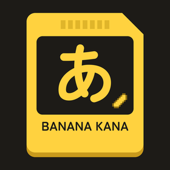

# Banana Kana

**Learn hiragana and katakana on your Anbernic RG DS Plus.**
Lessons, drills and stylus tracing for [BananaOS](https://github.com/JorreFog/bananalinux), using both screens.

[](https://github.com/Parzival3971/banana-kana/actions/workflows/build.yml)
[](https://github.com/Parzival3971/banana-kana/releases)
[](LICENSE)

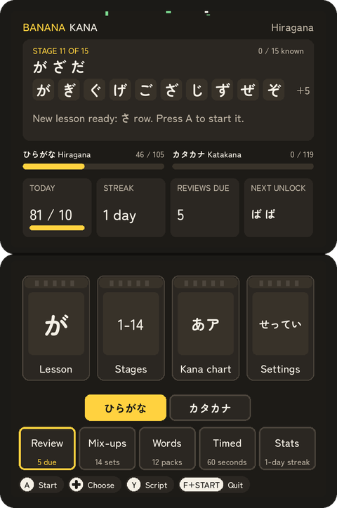 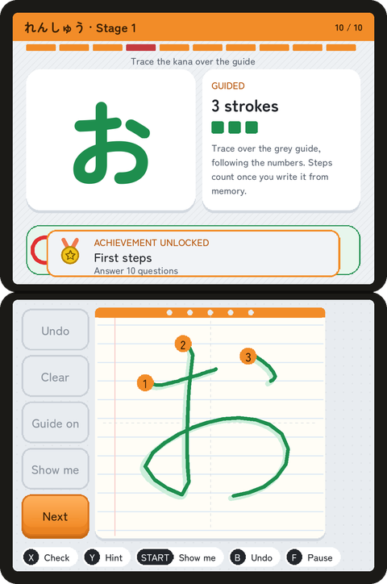 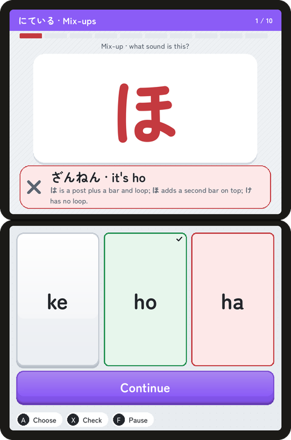

</div>

## Features

- **Stages, not a wall of kana.** 15 stages per script: the 10 basic rows, voiced kana (が, ぱ...), combinations (きゃ...),
  and an Extras stage for small っ, the long-vowel ー and katakana made for foreign words (ティ, ファ, ヴ...).
  That's 105 hiragana and 119 katakana. Katakana opens up once you've finished hiragana stage 10.
- **A lesson for every stage.** Each new kana gets a memory hint, stroke-order frames and a practice trace before it's tested.
- **Four kinds of drill:**
  - reading, from kana to sound and back;
  - word meanings, using only words made of kana you've unlocked;
  - writing, traced with the stylus and scored stroke by stroke (combination kana are traced in two parts);
  - typing, in romaji or on a kana keyboard.
- **One step at a time.** A brand-new kana is only asked as multiple choice. Typing comes once you've got it right,
  then writing: first over the full guide, then over a faint outline, then from memory, one level per session.
- **Already know some?** On first launch, say how much you know, or skip ahead later in Settings > Script.
  Skipped kana count as known, with a quick review in a day or two to check.
- **Progress that sticks.** A kana is *known* after 4 right answers spread over at least two sessions.
  Known kana then come back for **spaced review** after 1, 3, 7, 14, 30 and 90 days.
- **Mix-ups.** Short drills on look-alikes such as さ/き, ね/れ/わ, シ/ツ and ソ/ン, with a note on how to tell them apart.
  Pairs you've confused yourself are added too.
- **Timed challenge.** One-tap answers for 60 seconds, with a personal best for each script.
- **Practice sets and free writing.** Pick kana in the chart and drill just those (a single kana is mixed with its
  look-alikes), or write them freely with a full guide, an outline or none, without touching your progress.
- **Draw any kana.** Write whatever you like from memory and Banana Kana works out which kana it is, then checks your
  stroke order against it. Good for practising on your own.
- **See the stroke order.** Show me (or START) animates each stroke in turn. Arrows on the guide show which way each
  stroke goes.
- **Your kind of writing.** Kana in rounded print or a textbook handwriting font, canvas guide lines (cross, grid or
  none), ink thickness, and how strictly strokes are checked (relaxed, normal or strict).
- **Daily goal and streak**, plus a stats screen with your last 14 days and an accuracy heatmap of every kana.
- **Made for the device.**
  - Prompts on the top screen, answers and the tracing canvas on the touch screen.
  - Everything except the on-screen keyboards works with the d-pad and buttons too.
  - Dark and light themes, with text rendered at the panels' real resolution.
- **Safe to switch off.** Progress is saved after every answer, so closing the lid or powering off loses nothing.

<details>
<summary><b>More screenshots</b></summary>
<br>

| | | |
|:-:|:-:|:-:|
| 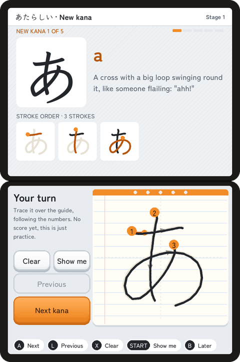<br>Lesson | 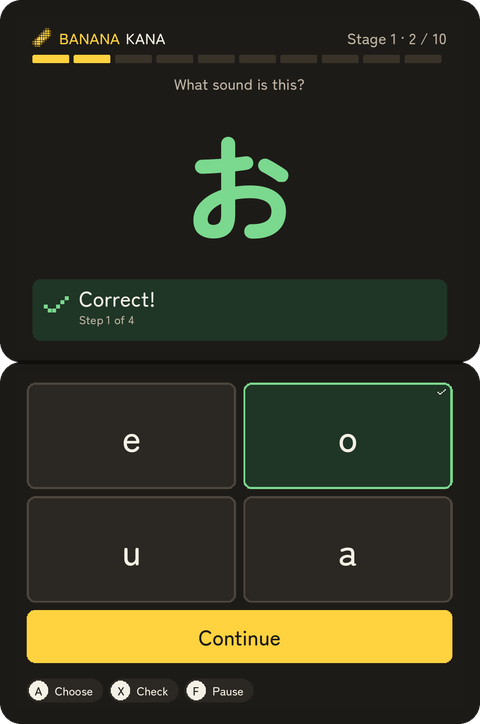<br>Reading | 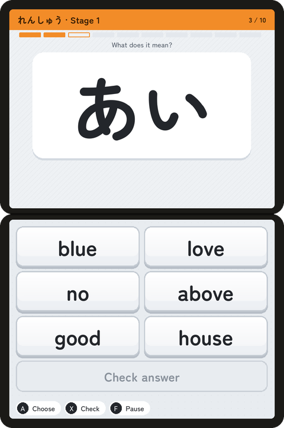<br>Word meanings |
| 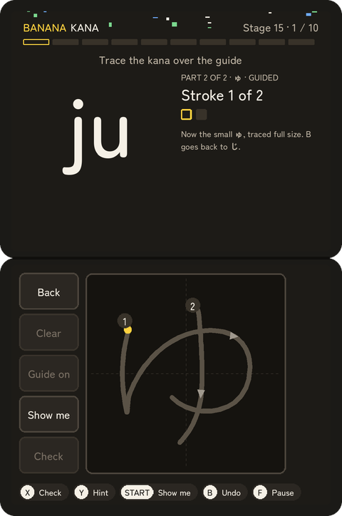<br>Writing a combination | 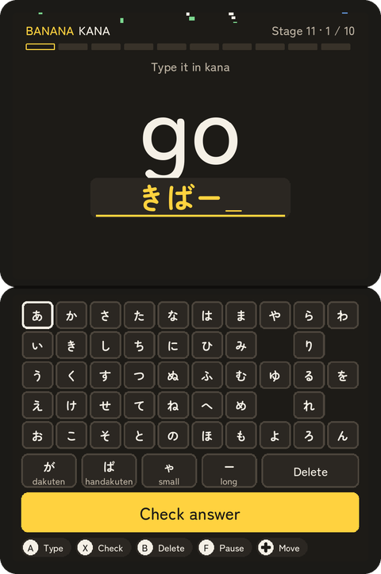<br>Kana keyboard | 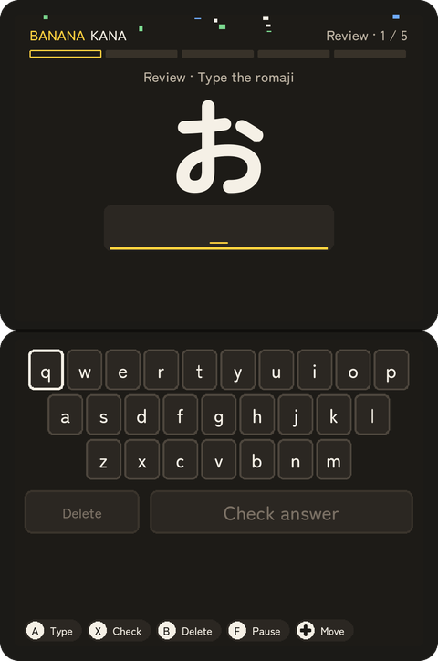<br>Spaced review |
| 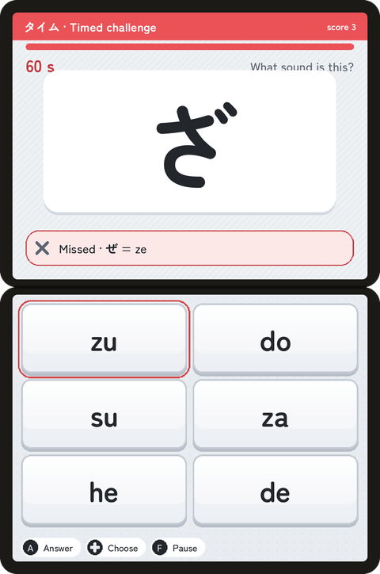<br>Timed challenge | 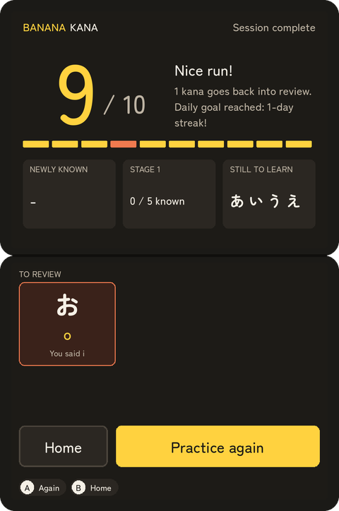<br>Results | 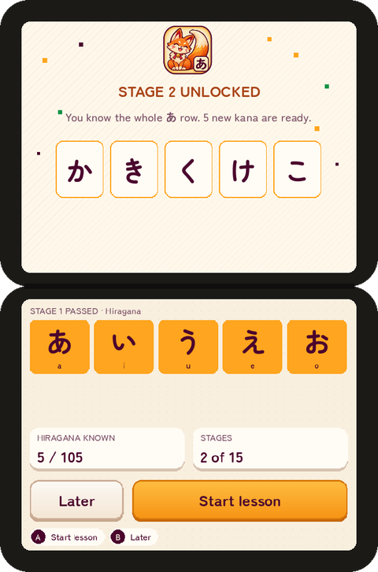<br>Stage unlocked |
| 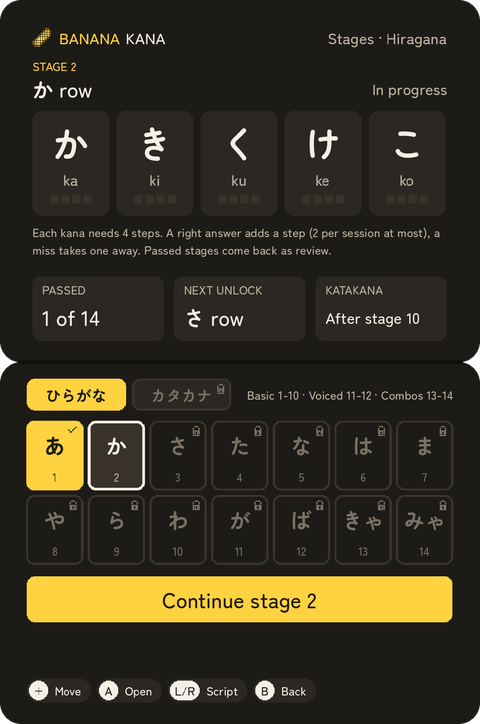<br>Stage map | 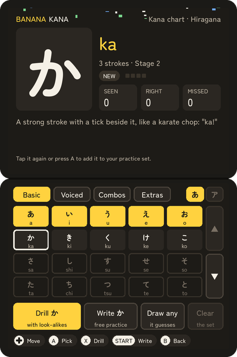<br>Kana chart | 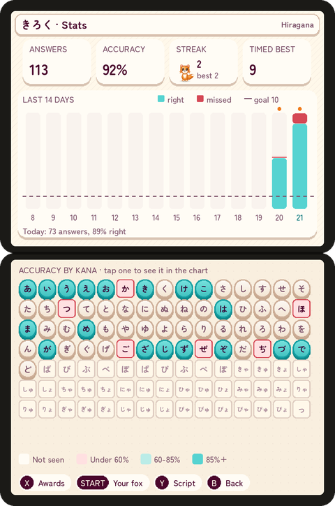<br>Stats |
| 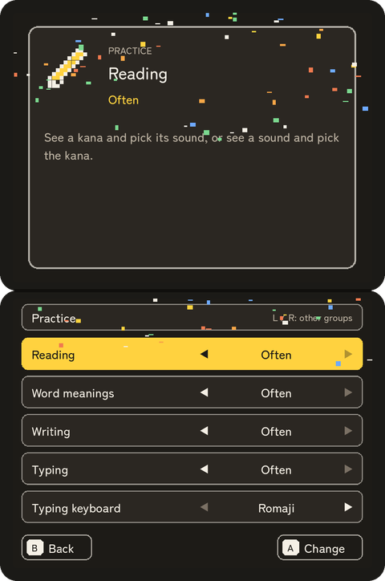<br>Settings | 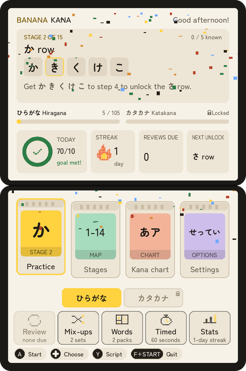<br>Light theme | 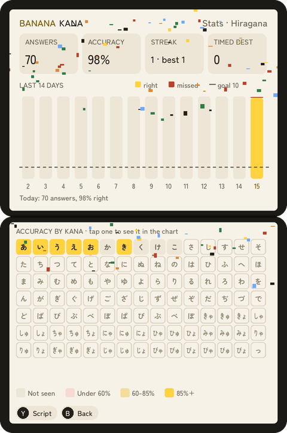<br>Light theme stats |
| 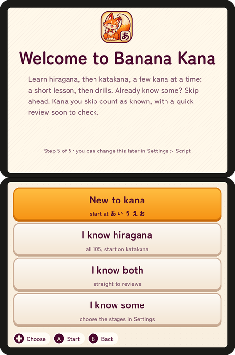<br>First launch | 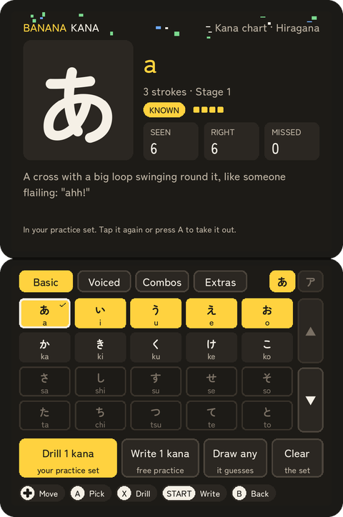<br>Practice set | 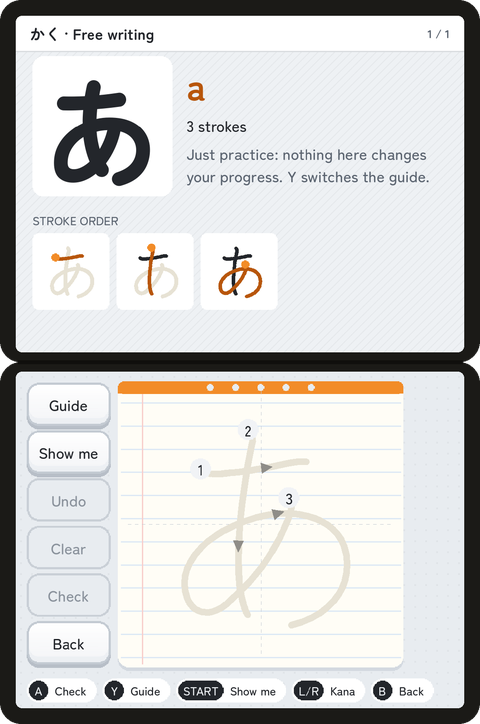<br>Free writing |
| 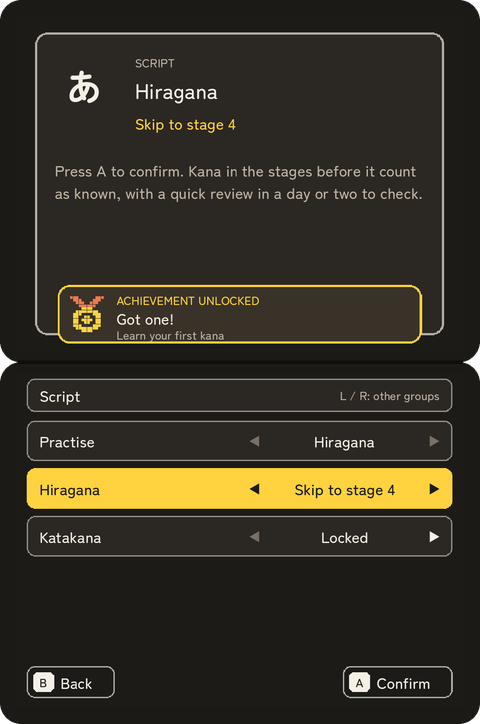<br>Skipping ahead | 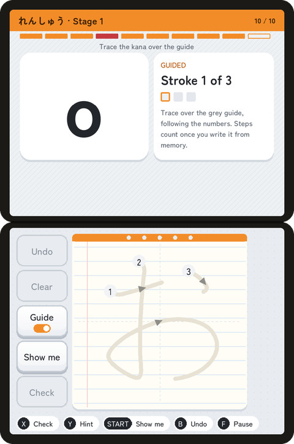<br>Guided writing | 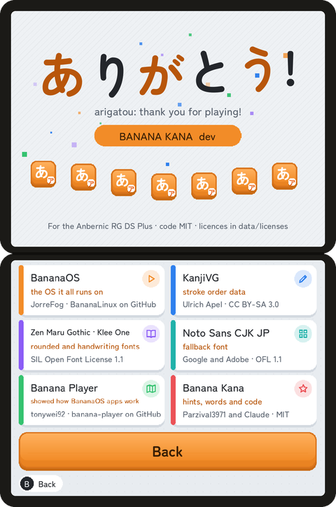<br>Credits |
| 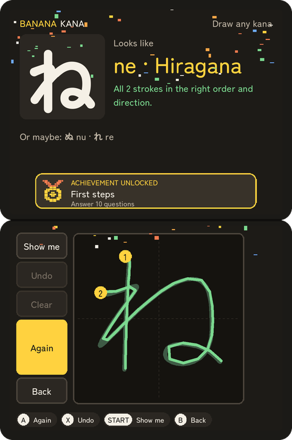<br>Draw any kana | 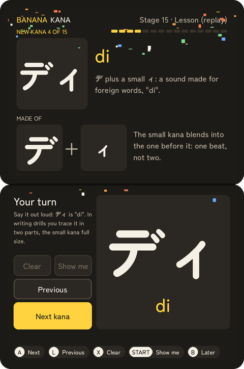<br>Extras stage | 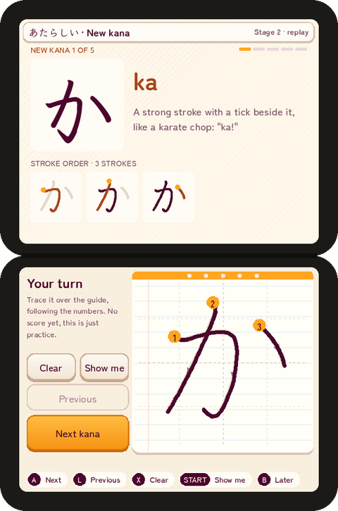<br>Handwriting font and grid |

</details>

## Install

You need an Anbernic RG DS Plus running BananaOS.

1. Download `BananaKana-<version>-aarch64.zip` from the [latest release](https://github.com/Parzival3971/banana-kana/releases).
2. Unzip it into `roms/ports` on the SD card. You should end up with:
   ```
   roms/ports/Banana Kana.sh
   roms/ports/BananaKana/
   roms/ports/media/box/Banana Kana.png
   ```
   > **On a Mac**, the zip may open into a folder of its own. Move the *contents* of that folder into `roms/ports`.
3. Put the card back, open the **Ports** shelf and choose **Banana Kana**.

**Updating:** unzip the new version over the old one. Your progress lives in `home/.config/banana-kana/` and is kept.
**Uninstalling:** delete the three items above. Delete `home/.config/banana-kana/` too if you want your progress gone.

## Controls

| | |
|---|---|
| **Stylus / touch** (bottom screen) | Tap answers, keys and buttons. Buttons act when you lift, so slide off to cancel. Trace on the canvas. |
| **D-pad** (shown as ✛ in the hint chips) | Move between tiles, cartridges, stages, chart cells and settings |
| **A** | Choose / confirm (press again on a chosen answer to check it) |
| **B** | Back. In drills: undo a stroke or delete a letter |
| **X** | Check the answer |
| **Y** | Hint while writing, guide in free writing. On Home and stats: switch hiragana / katakana |
| **START** | Show me (stroke-order animation) when writing; in the chart, write the practice set freely |
| **L / R** | Switch tabs, scripts or settings groups |
| **F** (or **SELECT**) | Pause during practice: resume, back to menu or quit |
| **F + START** | Quit from anywhere (BananaOS's F + SELECT works too) |

## How learning works

- **Steps.** Every kana has 4 steps. A right answer adds one, a wrong answer takes one away, and you can gain at most
  2 steps per kana in one session. Reaching step 4 means a kana is *known*, so it takes at least two sessions:
  that tests memory, not short-term recall.
- **Stages.** A stage unlocks when every kana in the stage before it is known. Practice mostly draws on your current
  stage, and older stages come back as review (you can turn this down in Settings > Sessions).
- **Spaced review.** A known kana is due again 1 day later, then 3, 7, 14, 30 and 90 days. Each right answer moves it
  to the next interval; a miss moves it back one and costs it a step, so it has to be re-learnt.
- **っ and ー.** These have no sound of their own, so they're practised by reading words that use them (きって = kitte,
  コーヒー = koohii), with near-miss answers that ignore the mark.
- **Mix-ups.** When you pick the wrong kana, the pair is remembered. Mix-up drills show only the look-alikes as options.
- **Staging.** Step 0: multiple choice only. Step 1: romaji typing too. Step 2: the kana keyboard and writing.
  Writing has its own three levels (full guide, outline, memory) and moves up one level per session. Guided writing
  is practice: it never costs a step. Writing from memory counts like any other answer, and a miss sends you back to
  the outline for a while.

## Settings

Six groups, laid out like BananaOS's own Settings app:

| Group | Settings |
|---|---|
| **Practice** | How often each drill appears, and whether typing uses a romaji or kana keyboard |
| **Sessions** | Session length, how much older stages come back, the daily goal and how strict the writing check is |
| **Script** | Which script you practise, and skipping ahead to a later stage (or unlocking katakana early) |
| **Display** | Dark or light theme, kana font (rounded or handwriting), canvas lines and ink |
| **Progress** | Your stats, and resetting progress (press twice; settings are kept) |
| **About** | Version and credits |

## Troubleshooting

- **The bottom screen stays dark.** The launcher switches the bottom backlight on, and the app keeps it on.
  If it's still dark after waking from sleep, quit and start the app again.
- **Something else is wrong.** Every launch writes `home/.config/banana-kana/launch.log` on the SD card. It lists the
  screens, touch device and controller it found. Please attach it when you
  [open an issue](https://github.com/Parzival3971/banana-kana/issues/new?template=bug_report.md).

## Building from source

Banana Kana is C++17 with SDL2 and SDL2_ttf, built with CMake. On a PC it opens the two screens as two windows,
and the mouse acts as the stylus.

```sh
# Debian/Ubuntu
sudo apt install cmake g++ libsdl2-dev libsdl2-ttf-dev
cmake -S . -B build && cmake --build build -j
ctest --test-dir build --output-on-failure                            # core logic tests
build/banana_kana --data app/data                                     # run it
SDL_VIDEODRIVER=dummy KT_SOFTWARE=1 build/banana_kana --selftest \
  --state-dir /tmp/kt --data app/data                                 # scripted run through every screen
```

On a PC, the keyboard stands in for the buttons:

| Key | Does |
|---|---|
| Arrow keys | D-pad |
| Enter | A |
| Esc / Backspace | B |
| Tab | Pause |
| Page Up / Page Down | L / R |
| Letters | Type romaji |

Your PC's progress is kept in `~/.config/banana-kana/`.

**Device build.** `scripts/docker-build-aarch64.sh` builds and tests an aarch64 binary in an arm64 Debian bookworm
container (it needs QEMU on x86). The binary links BananaOS's own SDL2 and is built against bookworm's glibc 2.36; BananaOS ships 2.41.
`dist/aarch64/REQUIREMENTS.txt` lists exactly what it needs. `scripts/package.sh <version>` then makes the Ports zip.

**Data and screenshots.**
- `python3 tools/gen_data.py` regenerates `app/data`: the kana, words, hints, KanjiVG strokes and font subsets.
  It needs `fonttools`.
- `scripts/screenshots.sh` regenerates `docs/img` from the self-test. It needs Pillow.

### Project layout

```
src/core.*       data, stages, progress (steps, spaced review, streak), question generation, stroke scoring
src/app.*        every screen, navigation, input mapping
src/gfx.*        themes, fonts and mixed-script text, shapes, icons, stroke drawing
src/main.cpp     start-up, event loop, evdev touch, gamepad, backlight keeper
src/selftest.cpp scripted UI run used in CI (and for the screenshots)
tests/           core logic tests
tools/           data, font and screenshot generators
launcher/        "Banana Kana.sh" for the Ports shelf, box art
scripts/         device build, packaging, release notes, screenshots
```

### Releases

Releases are made by GitHub Actions only, never by hand:

1. Add a section for the new version to `CHANGELOG.md`.
2. Bump `VERSION` on `main`.

The [release workflow](.github/workflows/release.yml) builds and tests the aarch64 binary, packages the zip and
publishes the release, using the changelog section as its notes. `0.0.0` in `VERSION` is a placeholder and never
releases. Every push also runs the [build workflow](.github/workflows/build.yml): a native build with the tests and
self-test, plus the arm64 build and a package dry run.

## Credits and licences

- **Code:** [MIT](LICENSE).
- **Stroke data:** [KanjiVG](https://kanjivg.tagaini.net/) © Ulrich Apel,
  [CC BY-SA 3.0](https://creativecommons.org/licenses/by-sa/3.0/). The sampled `app/data/strokes.txt` is shared
  under the same licence.
- **Fonts:** [Zen Maru Gothic](https://fonts.google.com/specimen/Zen+Maru+Gothic),
  [Klee One](https://fonts.google.com/specimen/Klee+One) and [Noto Sans CJK JP](https://github.com/notofonts/noto-cjk),
  all under the SIL Open Font License 1.1.
- **Text:** the lesson hints, words and look-alike notes were written for Banana Kana.
- **BananaOS:** [BananaLinux](https://github.com/JorreFog/BananaLinux) by JorreFog, the OS this all runs on.
- **Thanks:** [Banana Player](https://github.com/tonywei92/banana-player) for documenting how apps work on BananaOS.

## AI disclosure

Banana Kana is built with AI assistance. The C++ code, tests, data and build tools, CI workflows and these docs were
written by Claude (Anthropic) in Claude Code. The same goes for the lesson hints, look-alike notes and word list. The
maintainer directs the work, decides how the app should behave, and tests every build on a real RG DS Plus.
Commits written this way carry a `Co-Authored-By: Claude` trailer.

Stroke data (KanjiVG) and fonts are third-party work by people, credited above. The README screenshots are rendered
by the app's own self-test, not generated images. If you spot a mistake in a hint or a word, please
[open an issue](https://github.com/Parzival3971/banana-kana/issues).

Licence texts for all bundled data are in [`app/data/licenses`](app/data/licenses) and in the app under
Settings > About > Credits.
